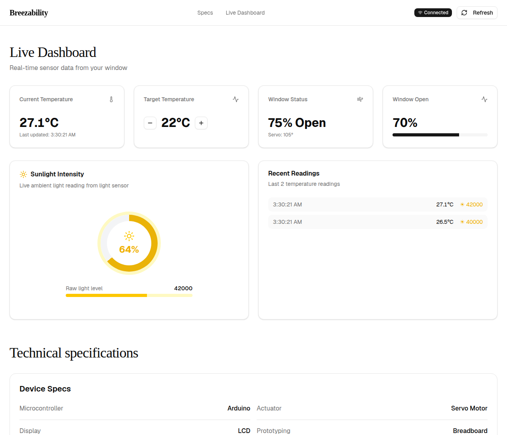

# Breezability

A smart window opener: an Arduino reads indoor temperature and ambient light,
a servo motor opens the window further as the room warms up, a FastAPI backend
exposes the live sensor data over HTTP, and a Next.js dashboard shows it in
real time.



_Screenshot: the dashboard running against the backend in mock mode
(`POST /api/mock?temperature=26.5&light_level=40000&servo_position=90`,
then a second reading at 27.1 °C / 42000 / 105°). No Arduino was attached._

---

## How it works

1. **Arduino** (`scripts/Servo_temp.ino`) samples the temperature sensor,
   takes the average of the first readings as a baseline, then every second
   computes `servo position = (current temp − baseline) × 100` and drives the
   servo. Warmer room → window opens further. It prints
   `Temperature: 25.50°C` followed by the raw ambient-light reading over
   serial, and shows the temperature on the LCD.
2. **Backend** (`scripts/backend.py`, FastAPI) reads the serial stream in a
   background thread, keeps the latest reading plus the last 100 in memory,
   and exposes them as a REST API. It mirrors the Arduino's servo math
   (baseline-relative, clamped 0–150) so the dashboard stays consistent even
   when the sketch's own position is not reported.
3. **Frontend** (`app/page.tsx`, Next.js) polls `/api/data` and
   `/api/history` every 2 seconds and renders temperature, target
   temperature, window status, % open, sunlight intensity, and recent
   readings.

## Hardware

Verified against `scripts/Servo_temp.ino` (not from memory — read the sketch):

| Component | Connection | Notes |
|-----------|-----------|-------|
| Temperature sensor (TMP36-style linear analog sensor) | Pin A0 | Sketch computes `temp = (voltage − 0.5) × 100`, `voltage = reading × 4.4 / 1023` |
| Servo motor | Pin 3 | `Window.attach(3)`; position 0–150 (see note below) |
| Ambient light sensor (SparkFun APDS9960) | I2C (SDA/SCL) | Raw ambient-light value, range ~0–65535 |
| 16×2 LCD | I2C, address `0x27` | Shows current temperature |
| Microcontroller | Arduino (Uno-compatible) | 9600 baud serial |

Arduino libraries needed: `Servo`, `LiquidCrystal_I2C`, `SparkFun_APDS9960`.

CAD for the window/wall assembly is in the repo root: `Assem2.DWG`,
`baseforwall.DWG`, `Door2D/3D.SLDPRT`, `Wall2D/3D.SLDPRT`, plus the
laser-cut layout `LazerCut.png`.

## Architecture

```
┌─────────────┐  serial 9600 baud   ┌──────────────┐  HTTP :8000   ┌──────────────┐
│  Arduino     │ ──────────────────▶ │  FastAPI      │ ────────────▶ │  Next.js     │
│  Servo_temp  │  "Temperature: …"   │  backend.py   │  /api/data    │  dashboard   │
│  .ino        │  "<light level>"    │  :8000        │  /api/history │  :3000       │
└─────────────┘                     └──────────────┘               └──────────────┘
```

### API

| Method | Endpoint | Description |
|--------|----------|-------------|
| `GET` | `/` | Health check — `{"status": "ok", "service": "breezability-backend"}` |
| `GET` | `/api/data` | Latest sensor snapshot (temperature, light_level, servo_position, target_temperature, window_status, last_updated, connected) |
| `GET` | `/api/history` | Last 100 readings |
| `POST` | `/api/target` | Set target temperature, JSON `{"temperature": 24.0}` |
| `GET` | `/api/status` | Arduino connection status (`connected`, `last_updated`) |
| `POST` | `/api/mock` | Inject fake data for UI testing without an Arduino: `?temperature=26.5&light_level=40000&servo_position=90` |

## Running the project

### 1. Upload the Arduino code

1. Open `scripts/Servo_temp.ino` in the Arduino IDE.
2. Install the libraries listed above.
3. Upload to your Arduino.
4. Note your serial port — Windows: Device Manager → Ports (`COM3`, `COM4`…);
   Linux: `/dev/ttyUSB0` or `/dev/ttyACM0`; macOS: `/dev/cu.usbserial-*`.

### 2. Start the backend

```bash
cd scripts
pip install fastapi uvicorn pyserial
# Tell it which serial port the Arduino is on (default is COM3):
export BREEZABILITY_SERIAL_PORT=/dev/ttyUSB0   # Linux/macOS; on Windows: set BREEZABILITY_SERIAL_PORT=COM3
python backend.py
```

The backend listens on `http://localhost:8000` (docs at `/docs`). Copy
`.env.example` to `.env` for the documented defaults — note the backend reads
the `BREEZABILITY_SERIAL_PORT` **environment variable**, it does not load the
`.env` file itself, so export it in your shell as above. (The Next.js
frontend does read `.env` automatically for `NEXT_PUBLIC_API_URL`.)

If no Arduino is attached, the serial thread logs an error and the backend
keeps running with `connected: false` — use the mock endpoint (step 4) to
exercise the dashboard.

### 3. Start the frontend

```bash
npm install
npm run dev
```

Open `http://localhost:3000`. The dashboard talks to the backend at
`$NEXT_PUBLIC_API_URL` (default `http://localhost:8000`).

Production build:

```bash
npm run build
npm run start
```

> **Build note:** `npm run build` fetches the Geist font from Google Fonts.
> In restricted networks it can fail with a TLS error
> (`Failed to fetch 'Geist' from Google Fonts`). The font fetch itself works
> — it is Turbopack's bundled certificates that are rejected. Retry with:
> `NEXT_TURBOPACK_EXPERIMENTAL_USE_SYSTEM_TLS_CERTS=1 npm run build`.

### 4. Testing without an Arduino

```bash
curl -X POST "http://localhost:8000/api/mock?temperature=26.5&light_level=40000&servo_position=90"
curl http://localhost:8000/api/data
curl http://localhost:8000/api/status
```

## What was actually written by hand

Honest scoping: the dashboard UI was scaffolded with **v0**, and
`components/ui/*` is stock **shadcn/ui** boilerplate (most of it unused by the
one-page dashboard). The parts written for this project are the Arduino sketch
(`scripts/Servo_temp.ino`), the FastAPI backend (`scripts/backend.py`), the
dashboard page (`app/page.tsx`), and the CAD files. Don't read this repo as
evidence of hand-written TypeScript proficiency — the TypeScript here is
overwhelmingly generated/template code.

## Project structure

```
├── app/page.tsx            # Live dashboard (the homepage)
├── app/layout.tsx          # Root layout, metadata
├── components/ui/*         # shadcn/ui components (mostly unused — see above)
├── docs/screenshots/      # Dashboard screenshot (mock data)
├── scripts/
│   ├── Servo_temp.ino      # Arduino firmware: temp + light + servo + LCD
│   ├── backend.py          # FastAPI backend (serial reader + REST API)
│   ├── serial_reader.py    # Standalone Stage-1 reader — see Limitations
│   └── pyproject.toml      # Backend dependencies (fastapi, uvicorn, pyserial)
├── Assem2.DWG, baseforwall.DWG, *.SLDPRT, LazerCut.png   # CAD / laser-cut files
├── .env.example            # BREEZABILITY_SERIAL_PORT, NEXT_PUBLIC_API_URL
└── package.json            # Next.js 16 / React 19 frontend ("breezability")
```

## Known limitations

- **Target temperature is display-only.** The dashboard's +/− control posts
  to `POST /api/target` and the backend stores the value, but the Arduino
  sketch never receives it — the firmware opens the window relative to its
  own startup baseline, not to a target. Closing that loop (sending the
  target to the Arduino and having the sketch use it) is the obvious next
  feature.
- **Servo clamp mismatch.** The backend clamps servo position to 0–150; the
  sketch writes positions up to 180 and only clamps values ≥ 150 back to
  150, so for a 1.5–1.8 °C rise above baseline the sketch can drive the
  servo past the backend's model. The dashboard's "% open" is
  `servo_position / 150`.
- **Startup readings.** In `setup()` the sketch prints bare temperature
  numbers (no `Temperature:` prefix) while establishing its baseline; the
  backend files any bare number as a light reading, so `light_level` is
  briefly wrong in the first ~6 seconds after the Arduino resets.
- **`scripts/serial_reader.py` is dead code.** A Stage-1 standalone reader
  that expects a `TEMP:`/`SERVO:` serial format the sketch never emits, and
  nothing imports it. Kept for reference; `backend.py` has its own serial
  thread.
- **No tests.** Nothing in the repo is covered by automated tests.
- **No hardware photos.** The screenshot above is the dashboard only; there
  are no photos of the assembled window hardware.
